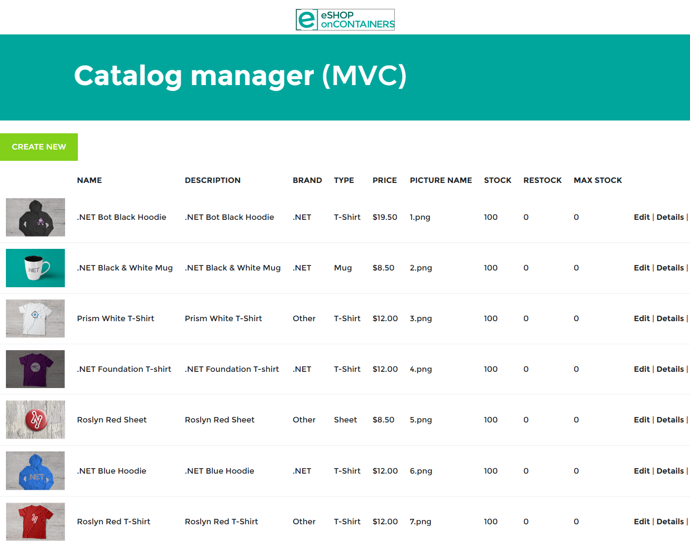

# .NET Framework 4.7.2 → .NET 10 migration case study

A real legacy ASP.NET MVC 5 + Web API 2 + EF6 app (Microsoft's open-source *eShopLegacyMVC*), migrated to **ASP.NET Core on .NET 10 LTS**, with the same pages, URLs, API contract and **the same database**.

| | Before | After |
|---|---|---|
| Cold start (existing DB) | 19.8 s | **3.4 s** |
| Catalog page (median) | 13.8 ms | **4.7 ms** |
| Memory | 295 MB | **141 MB** |
| Automated tests | 0 | **25** |
| Data migration needed | | **none** (existing DB adopted with one idempotent script) |

📄 **Full write-up: [MIGRATION-REPORT.md](MIGRATION-REPORT.md)**. It covers what changed, 9 issues found (3 of them invisible to the compiler and the tests), the breaking changes, and a cut-over runbook.



## Run it
```bash
dotnet test
dotnet run --project src/eShopLegacyMVC
```
Uses SQL Server LocalDB by default (`appsettings.json`). Set `UseMockData=true` to run without a database.

## Compare with the original
```bash
git diff before -- src/
```

## Layout
- `src/eShopLegacyMVC`: the web app (.NET 10)
- `eShopLegacy.Utilities`: class library (BinaryFormatter replaced by System.Text.Json)
- `tests/`: xUnit + `WebApplicationFactory`
- `db/`: adopt-existing-database script and schema signature query
- `docs/`: baseline vs migrated output, comparison script, screenshots

Original code © .NET Foundation, MIT. See [NOTICE.md](NOTICE.md).
